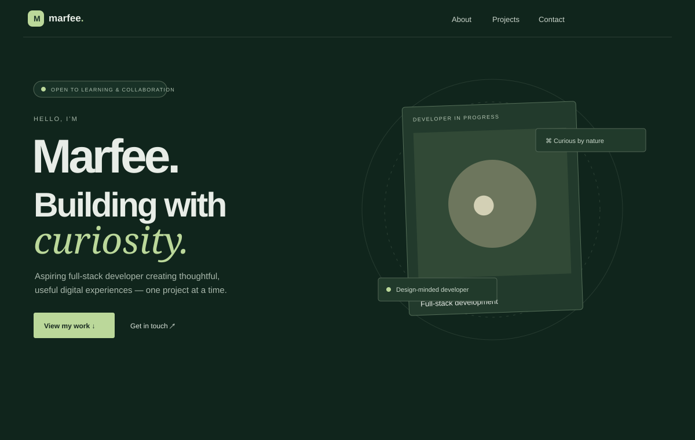

# Marfee — Developer Portfolio

A responsive dark green portfolio built with Vue and Vuetify. It includes interactive project previews and a contact form connected to a Laravel API backed by PostgreSQL.

## Preview



## Stack

- Vue 3, Vuetify, Vue Router, Vite, plain CSS
- GSAP entrance and scroll reveal animations
- Laravel 12 API, PHP 8.2+
- PostgreSQL

## Run locally

Install the frontend packages and start Vite:

```sh
npm install
npm run dev
```

Set up the API in another terminal. Copy `.env.example` to `.env`, create a PostgreSQL database named `marfee_portfolio`, then enter your database credentials. The `VITE_API_URL` value in that file points the contact form to the local API.

```sh
composer install
php artisan key:generate
php artisan migrate
php artisan serve
```

The health check is `GET /api/health`. The contact form sends `POST /api/contact` with name, email, and message fields. The endpoint validates messages and allows up to five submissions per minute per visitor.

The Verdant preview remembers watering, the Daily Focus checklist saves tasks in the browser, and Kape Journal saves and browses notes. Each preview works independently of the API.

## Build

```sh
npm run build
```

Vercel build settings are included in `vercel.json`. Set `VITE_API_URL` to the deployed Laravel endpoint when deploying the frontend. The API needs a PHP host and a PostgreSQL database.
